# Frontier — a graphical front end for MiSTer

> **Beta.** Frontier is used daily on a real MiSTer, but it is still young: bug
> reports and suggestions are welcome.

Frontier is a fork of [Main_MiSTer](https://github.com/MiSTer-devel/Main_MiSTer)
that replaces **only** the game selection screen of the menu core with a
themeable graphical front end drawn on the framebuffer. Everything else
(core loading, OSD, input, video) is the upstream code.

* Main screen by category (Arcade, Computer, Console, Handheld, Other), games
  listed by title with all their regions and versions in the details.
* Box art, screenshots, titles, marquees and **video** (mp4 decoded on the ARM
  core, with sound), descriptions and metadata scraped from ScreenScraper and
  Wikipedia, by a scraper that also runs from the settings screen.
* Favorites, Recent games, My Lists (by hand or from a filter on the metadata).
* Themes in plain `.ini` files (City Pop in three colours and Simple are
  included), a theme editor (one standalone file for the PC, [`theme_editor.html`](https://github.com/ElFDA/FrontierMr/releases/latest/download/theme_editor.html) on the Releases page) and a step by step
  theme guide.
* Screensaver with random games, loading screens drawn by the theme, Coin-Op
  mode (last game at power on, panic combo), CRT output next to HDMI.
* Safe with `update_all`: updates never put the official firmware back over
  Frontier's, update_all also updates Frontier, and one script brings the
  official firmware back.

## Screenshots

Taken on a real MiSTer with the `citypop_blue` theme.

<table>
<tr><td align="center">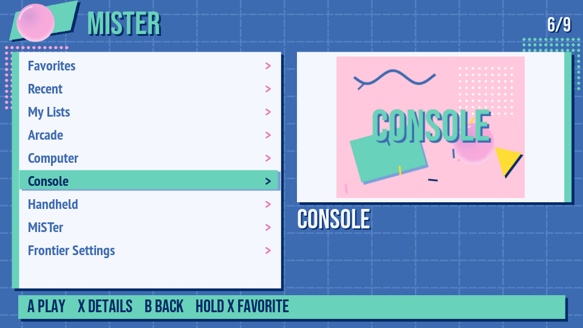<br><sub>Main screen: categories, Favorites, Recent, My Lists and the settings</sub></td><td align="center">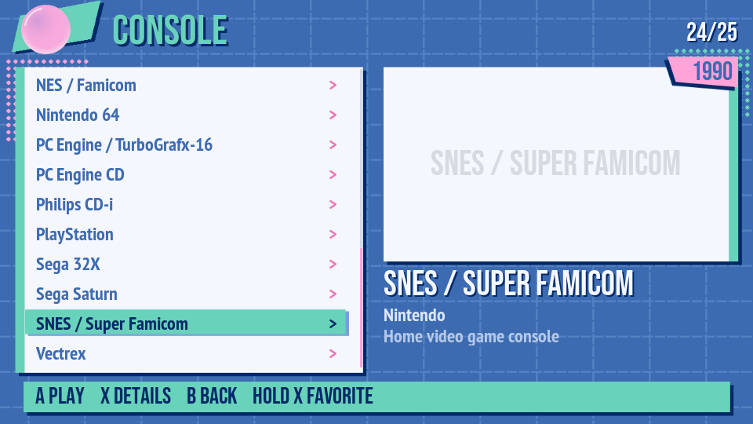<br><sub>Consoles, with the data of each system taken from Wikipedia</sub></td></tr>
<tr><td align="center">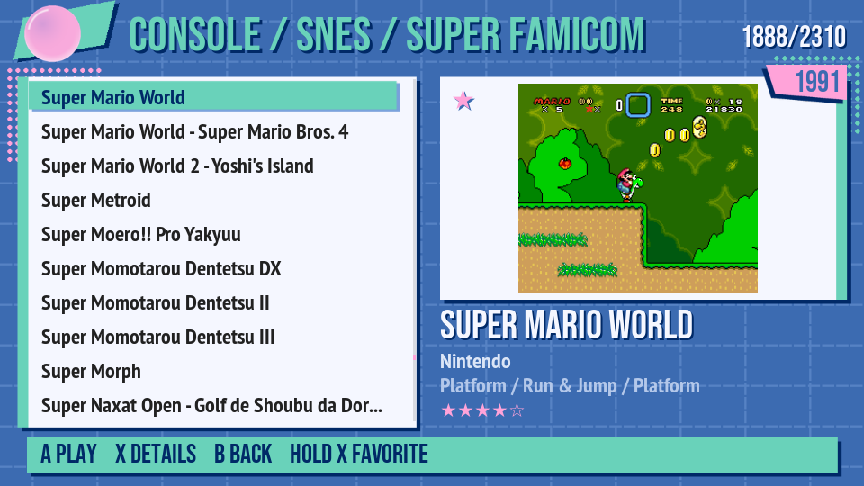<br><sub>A system's games, by title, with the video of the highlighted one</sub></td><td align="center">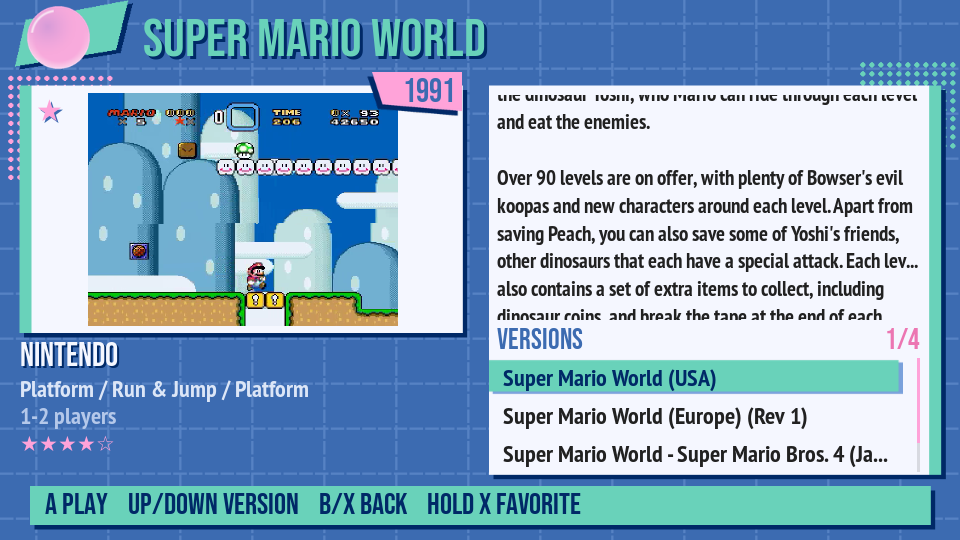<br><sub>Details (X): description, metadata and every version and region</sub></td></tr>
<tr><td align="center">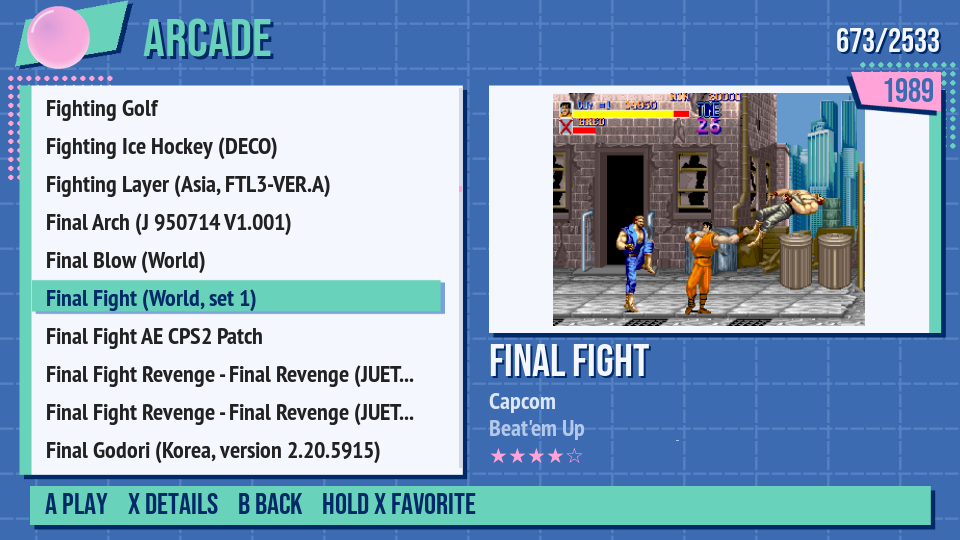<br><sub>Arcade: games by title, grouped by MAME set</sub></td><td align="center">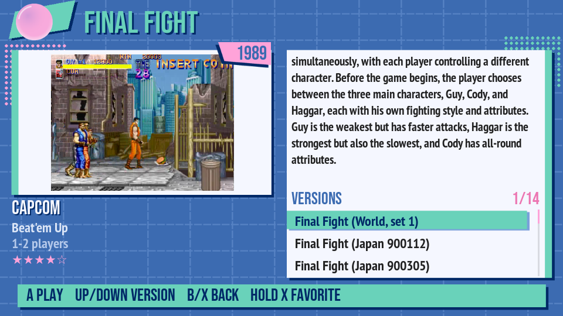<br><sub>Arcade details with the available versions</sub></td></tr>
<tr><td align="center">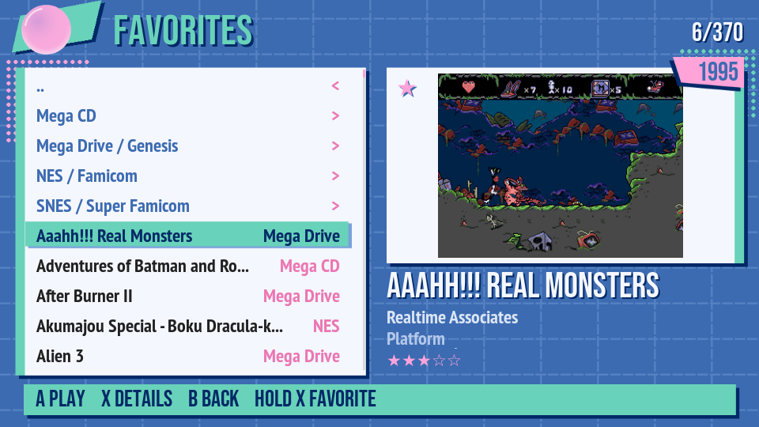<br><sub>Favorites, per system or in a single list (hold X on a game)</sub></td><td align="center">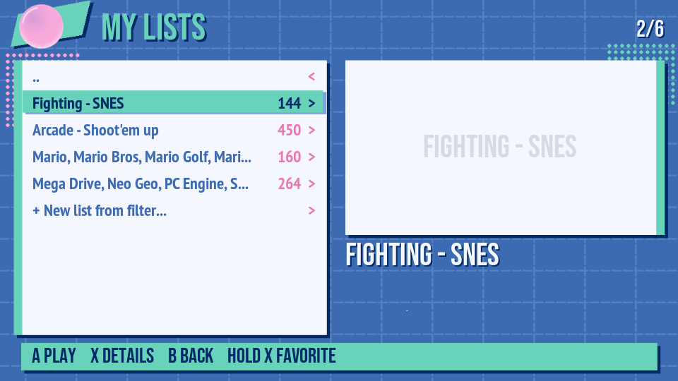<br><sub>My Lists: your own lists, by hand or from a filter</sub></td></tr>
<tr><td align="center">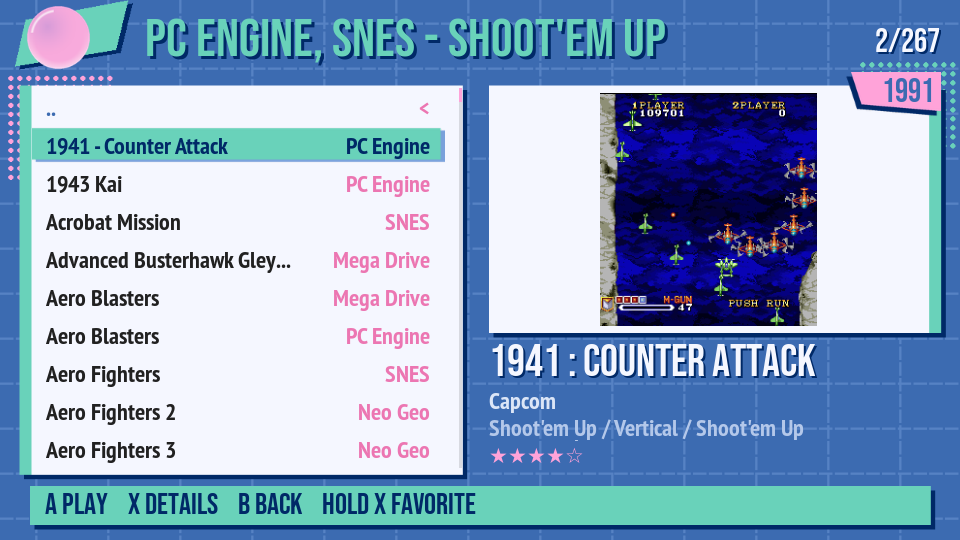<br><sub>A list with games from several systems (here, shoot'em ups)</sub></td><td align="center">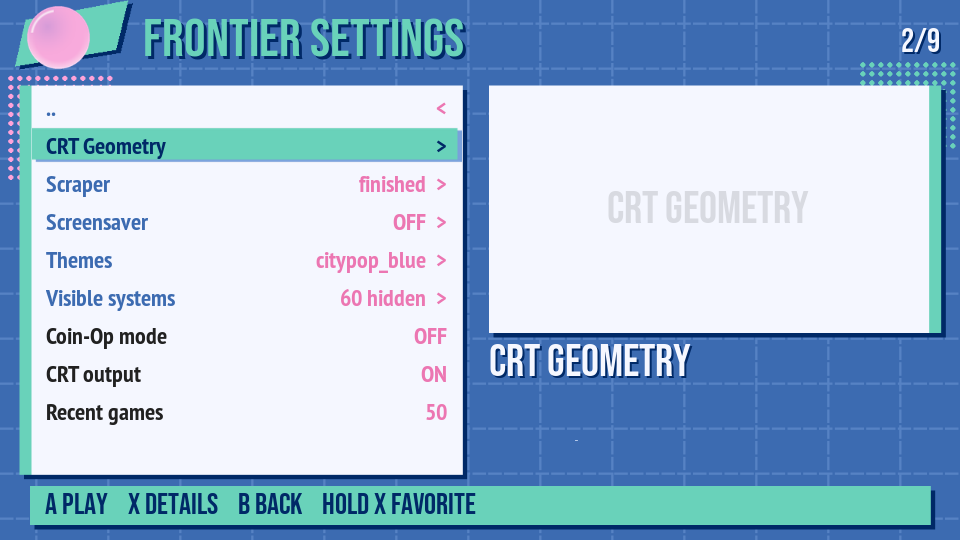<br><sub>Frontier Settings: scraper, screensaver, themes, visible systems, Coin-Op</sub></td></tr>
<tr><td align="center">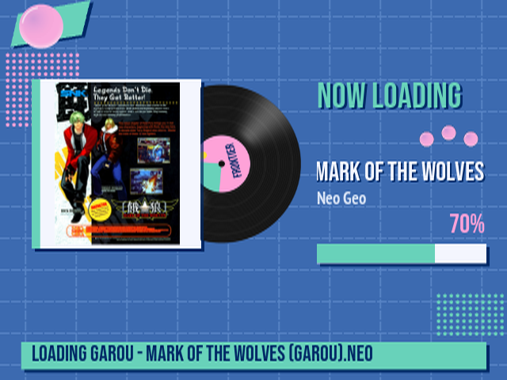<br><sub>Loading screen drawn by the theme (here Garou, Neo Geo; 4:3 on a CRT)</sub></td></tr>
</table>

## Install

Either way, the scripts are in the MiSTer menu: F12 -> Scripts.

**Through update_all**
1. Copy [downloader_frontiermr.ini](https://github.com/ElFDA/FrontierMr/releases/latest/download/downloader_frontiermr.ini)
   to the root of the SD card (`/media/fat`).
2. Run update_all: it downloads Frontier into `/media/fat/frontier`.
3. F12 -> Scripts -> `frontier_install`. The MiSTer reboots into Frontier.

**From the release ZIP**
1. Download the ZIP of the [latest release](https://github.com/ElFDA/FrontierMr/releases/latest) and copy
   the contents of its `SD` folder to the root of the SD card.
2. F12 -> Scripts -> `frontier_install`. The MiSTer reboots into Frontier.
   It also adds Frontier's database for update_all (`downloader_frontiermr.ini`,
   in the root of the SD), so Frontier is updated by update_all together with
   everything else.

With a CRT on the VGA output of the analog I/O board, also run
F12 -> Scripts -> `frontier_crt` (or, in Frontier, Frontier Settings ->
CRT output). Run it again to turn it off.

Then use update_all as usual. Frontier keeps your settings, favorites, lists
and scraped media through updates.

| Script | What it does |
|---|---|
| `frontier_install` | installs Frontier (or a new version from a ZIP) |
| `frontier_uninstall` | back to the official firmware; Frontier's files and media stay |
| `frontier_on_off` | Frontier's screen off (original core browser) or on again |
| `frontier_crt` | Frontier also on the CRT of the VGA output, on or off |

The scraper (game data, pictures, videos) runs from Frontier: Frontier
Settings -> Scraper; a single game from its details (X) -> Scrape this game.

In a game: OSD (F12) -> Core opens the list of the cores as usual; Alt+F12,
or L+R+Select+Start held for 2 seconds on the joypad, goes back to Frontier.

## MiSTer.ini

The main settings of `/media/fat/MiSTer.ini` for each setup; the other
options can keep their default values. Keep a copy of the ini before changing
it. Two setups can live in two ini files (e.g. `MiSTer.ini` and
`MiSTer_TV.ini`), chosen from the OSD.

### CRT only

VGA output of the analog I/O board to a TV or PVM (RGB SCART):

```ini
[MiSTer]
vga_scaler=0           ; VGA = original video of the core (15 kHz)
forced_scandoubler=0   ; 1 only for a 31 kHz VGA monitor
composite_sync=1       ; composite sync for TV/PVM over SCART
                       ; (vga_sog=1 if the cable uses sync on green)
vga_mode=rgb           ; ypbpr for component
direct_video=0

[Menu]
direct_video=1         ; Frontier at 640x240 on the VGA too
menu_pal=0             ; 1 if the CRT does not take NTSC
```

Without `direct_video=1` in `[Menu]` the menu shows noise on the VGA:
`frontier_crt` sends Frontier to the CRT without changing `MiSTer.ini` (the
OSD is seen on the CRT even then). With an HDMI to VGA DAC instead of the I/O
board: `direct_video=1` in `[MiSTer]` (2 for DACs that report 1024x768) and
`composite_sync=1`.

### HDMI only

```ini
[MiSTer]
video_mode=8           ; 1920x1080@60 (0 = 720p, 14 = 1440p)
vsync_adjust=2         ; low latency (1 if the TV loses the signal)
vscale_mode=0          ; 1 = integer scale only
direct_video=0         ; with 1 the TV gets raw 240p
hdmi_limited=0

[Menu]
fb_size=2              ; faster Frontier: the menu at 960x540, scaled up
```

and CRT output OFF (`crt=0` in `frontier/frontier.ini`, the default).

### CRT and HDMI together

```ini
[MiSTer]
video_mode=8
vsync_adjust=2
direct_video=0         ; scaled HDMI on the TV
vga_scaler=0           ; native 15 kHz on the CRT
composite_sync=1
forced_scandoubler=0

[Menu]
video_mode=8
direct_video=0
fb_size=2
```

and CRT output ON (`frontier_crt`, or Frontier Settings -> CRT output). Games
always come out on both; Frontier's own menu core shows the menu in HD on the
TV and at 240p on the CRT at the same time, each with its own layout of the
theme. The size and position of the picture on the CRT are in Frontier
Settings -> CRT Geometry.

### To avoid

* `direct_video=1` in `[MiSTer]` with an HDMI TV: it is only for DACs.
* `vga_scaler=1` with a 15 kHz CRT: the VGA gets the scaler output, 31 kHz or
  more.
* `vscale_mode` other than 0 or 1 in `[MiSTer]`: the loading screen of the
  games loses the sync, on the HDMI and on the CRT.

## Guides

* User guide: [tools/fe/sd/frontier/README.txt](tools/fe/sd/frontier/README.txt)
  (Italian: [LEGGIMI_ita.txt](tools/fe/sd/frontier/LEGGIMI_ita.txt)), also on
  the SD card in `/media/fat/frontier`.
* Step by step:
  * [Scraper](docs/SCRAPER.md): the ScreenScraper account (where to write user
    and password, what you get without it), what to download, regions of the
    pictures, space ([italiano](docs/SCRAPER_ita.md)).
  * [Favorites, Recent and My Lists](docs/LISTS.md): lists by hand and from a
    filter on the data of the games ([italiano](docs/LISTS_ita.md)).
  * [Games on more disks and network shares](docs/STORAGE.md): SD card, second
    USB disk, CIFS shares in one list ([italiano](docs/STORAGE_ita.md)).
  * [Which version of a game starts](docs/VERSIONS.md): the default region and
    version, `regions=`, the other versions ([italiano](docs/VERSIONS_ita.md)).
  * [Coin-Op mode](docs/COINOP.md): the last game at power on, the countdown,
    its protections ([italiano](docs/COINOP_ita.md)).
  * [A game shows a black screen](docs/BLACK_SCREEN.md): how to get the MiSTer
    back, the usual causes ([italiano](docs/BLACK_SCREEN_ita.md)).
  * [Theme editor](docs/THEME_EDITOR.md): make a theme on the PC with the
    standalone `theme_editor.html` ([italiano](docs/THEME_EDITOR_ita.md)).
* Theme guide: [THEME_GUIDE.txt](tools/fe/sd/frontier/THEME_GUIDE.txt)
  (Italian: [GUIDA_TEMA_ita.txt](tools/fe/sd/frontier/GUIDA_TEMA_ita.txt)).
* How Frontier stays installed through updates and how to go back to the
  official firmware: [docs/UPDATE_PROTECTION.md](docs/UPDATE_PROTECTION.md).
* How Frontier hooks into Main_MiSTer: [docs/ARCHITECTURE.md](docs/ARCHITECTURE.md).
* Something does not work: open an [issue](https://github.com/ElFDA/FrontierMr/issues/new/choose)
  (English or Italian); the form asks for the version, the video output and the
  messages that help.

## For developers

| Path | What |
|---|---|
| `frontier.cpp/.h`, `fe_*.cpp/.h` | Frontier itself |
| `menu.cpp`, `video.cpp/.h`, `input.cpp`, `fpga_io.cpp`, `Makefile` | upstream files with small hooks marked `// FRONTIER` |
| `tools/fe/sd/frontier/` | what goes to `/media/fat/frontier/` on the SD card: themes, `systems.ini`, scraper, update protection, guides |
| `tools/fe/sd/Scripts/` | the scripts of the Scripts menu |
| `tools/fe/` | package and update database (`package.py`, `make_db.py`), tests, helper scripts (deploy, screenshots of the framebuffer, theme preview and editor), `fe_av/` (the video library), `menu_frontier.patch` |
| `docs/` | step by step guides (scraper, lists, versions, Coin-Op, black screen), architecture and update protection |

### Build

Same as Main_MiSTer, with the ARM toolchain 10.2 (not the distribution's gcc):

```
export MISTER_GCC_INSTALL_DIR=/path/to/toolchains
source ./setup_default_toolchain.sh
make -j8        # bin/MiSTer
```

Video playback needs `lib/fe_av.so`, built by `tools/fe/fe_av/build.sh`
(FFmpeg 7.1.1, LGPL build, see `tools/fe/sd/frontier/lib/FFMPEG_LICENSE.txt`).
Without it Frontier works as well, with pictures only.

`tools/fe/package.py --release TAG --owner USER` makes the ZIP of a release
and the database that lets update_all update Frontier: it takes every file
from that ZIP (`tools/fe/make_db.py`), so a release is the ZIP plus
`downloader_frontiermr.ini`.

### Menu core

The CRT output next to HDMI (two screens at once) needs a modified menu core:
`tools/fe/menu_frontier.patch` applies to
[Menu_MiSTer](https://github.com/MiSTer-devel/Menu_MiSTer) (`menu.sv`,
`rtl/console_out.sv`). Frontier loads it from `frontier/bin/menu.rbf`; the
official `menu.rbf` stays in the root of the SD card and keeps updating.

## Notes

* ScreenScraper: the scraper uses the developer key of this project plus **your
  own** ScreenScraper account (Frontier Settings -> Scraper, or
  `scraper/scraper.ini`, see `scraper.ini.example`). The key is not in this
  repository, only in the release packages (`tools/fe/ss_key.py`); please do
  not reuse it in other programs. Builds without it scrape from the other
  sources, or with your own developer key in `scraper.ini`.
* Upstream README: [README_MiSTer.md](README_MiSTer.md).

## Thanks

To **[pierinolartista](https://www.twitch.tv/pierinolartista)**, the best
beta tester in the world, able to break any software, even the most stable
one. Every bug found there made Frontier better.

To **Dedaloso**, for the City Pop theme and for the pictures of the categories and
of the systems in the themes.

## License

GPL-3.0 as the upstream project, see [LICENSE](LICENSE). The fonts and
libraries bundled with the themes keep their own licenses: see
[NOTICE.md](NOTICE.md).
